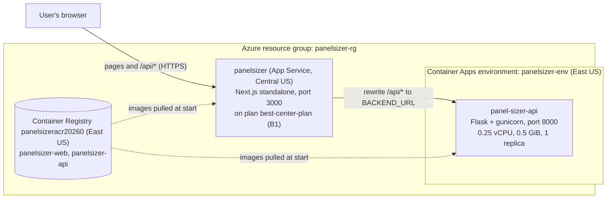
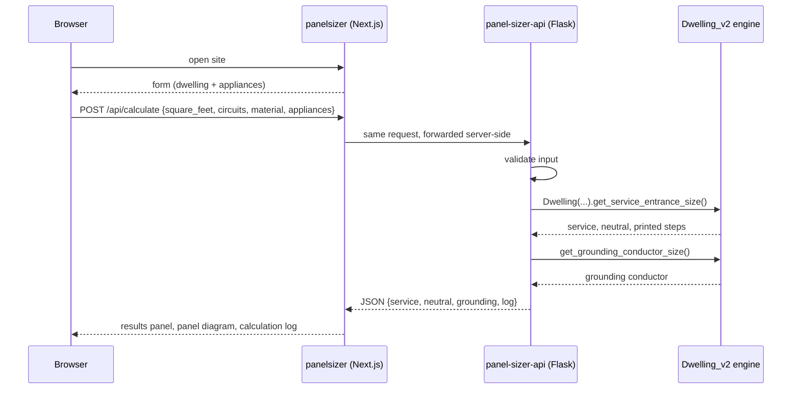
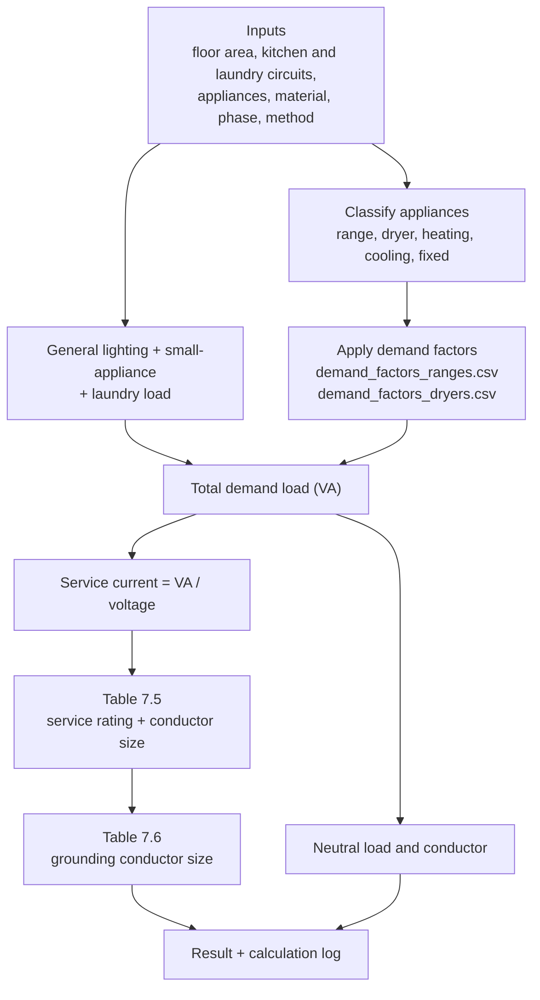
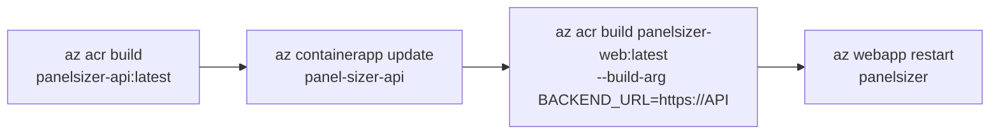

# PanelSizer

Web tool that sizes the electrical service entrance of a single dwelling. The
user enters floor area, branch circuits, conductor material and a list of
appliances. The tool returns the calculated load, the service rating, and the
service, neutral and grounding conductor sizes, with a step-by-step
calculation log.

| Folder | What it is |
|---|---|
| `frontend/` | Next.js + TypeScript screens ([frontend/FRONTEND_FLOW.md](frontend/FRONTEND_FLOW.md)) |
| `api/` | Flask API, one endpoint: `POST /api/calculate` |
| `backend/` | Calculation engine (`Dwelling_v2.py`) and demand-factor tables |
| `docker-compose.yml` | Runs both containers locally |
| `AZURE_DEPLOY.md` | Step-by-step Azure commands |

## Concepts in one minute

- **NEC load calculation.** The engine adds general lighting load from floor
  area, small-appliance and laundry circuits, and appliance loads, then
  applies NEC demand factors (ranges, dryers, fixed appliances, the larger of
  heating or cooling). The result is the demand load in volt-amperes.
- **From load to conductor.** Demand load divided by service voltage gives
  the current. Lookup tables (Krarti Tables 7.5 and 7.6, NEC 310.15(B)(6) and
  250.66) turn that into a service rating and conductor sizes for copper or
  aluminum.
- **Container.** Each half is packed into a Docker image with everything it
  needs, so it runs the same on a laptop and on Azure.
- **Container registry.** Images are built in Azure (`az acr build`) and
  stored in Azure Container Registry.
- **Container Apps.** Azure runs the images and gives each app an HTTPS
  address. A replica is one running copy; `--min-replicas 1` keeps one copy
  always on.
- **Server-side proxy.** The browser only talks to the frontend. A Next.js
  rewrite forwards `/api/*` to the Flask container, so there is no CORS
  problem and the API address is never exposed to the page.
- **Build-time configuration.** `BACKEND_URL` is read when the frontend image
  is built, not when it starts. Every frontend rebuild must pass
  `--build-arg BACKEND_URL=...`.

## System architecture on Azure



Live address: `https://panelsizer.azurewebsites.net`

The frontend runs as the App Service web app `panelsizer` (resource group
`panelsizer-rg`) on the BEST Center Tool plan `best-center-plan`, from the
image `panelsizer-web:latest`, with `WEBSITES_PORT=3000`. It replaced the
Container Apps frontend on 2026-10-08. The plan lives in the resource group
`best-center-tool-rg`. The API is still the container app `panel-sizer-api`.
After rebuilding the web image, restart the web app to pull it:
`az webapp restart -n panelsizer -g panelsizer-rg`.

## How a calculation runs



## Inside the calculation



Request body for `POST /api/calculate`:

```json
{
  "square_feet": 2000,
  "kitchen_circuits": 2,
  "laundry_circuits": 1,
  "material": "copper",
  "method": "Standard",
  "phase": 1,
  "appliances": [{ "name": "Range", "power_watts": 12000, "voltage": 240 }]
}
```

## How a change gets deployed



Exact commands, including how to recover the shell variables in a new
terminal: [AZURE_DEPLOY.md](AZURE_DEPLOY.md) sections 1 to 3.

## Run locally

With Docker:

```bash
docker compose up --build      # open http://localhost:3000
```

Without Docker:

```bash
# API on http://localhost:8000
cd api
python3 -m venv venv
source venv/bin/activate
pip install -r requirements.txt
python3 app.py

# Frontend on http://localhost:3000
cd frontend
npm install
npm run dev
```

`./start.sh` starts both at once.

## Cost: keeping it live 24 hours a day

| Piece | Runs on | Approx. cost |
|---|---|---|
| Website | App Service web app on `best-center-plan` (B1), shared with the BEST Center Tool | No extra charge beyond that plan (~$13/month, counted under `best-center-tool-rg`) |
| API, one replica, always on | Container Apps, consumption plan | Billed per second of CPU and memory; partly covered by the monthly free grant |
| Image storage | Container Registry, Basic | ~$5/month |

Figures are estimates from the setup notes, not invoices. Check the real
number under Cost Management for `panelsizer-rg`.

Scale-to-zero is the usual Container Apps saving, but it causes a 10–30 second
cold start, so it is ruled out here. With one replica always on:

1. Give the API container the smallest size. **Applied on 2026-10-05**: it
   went from 0.5 vCPU / 1 GiB (max 2 replicas) to 0.25 vCPU / 0.5 GiB
   (exactly 1 replica), which halves the always-on charge. Measured memory use
   was about 66 MB, so there is ample headroom:
   ```bash
   az containerapp update -n panel-sizer-api -g $RG --cpu 0.25 --memory 0.5Gi --min-replicas 1 --max-replicas 1
   ```
   An always-on replica that is not handling requests is billed at the lower
   idle rate, so a small idle replica is cheap. Raise `--max-replicas` again
   only if real traffic needs it.
2. Cap the log volume. The environment sends container logs to a Log
   Analytics workspace, which bills per GB. Keep application logging quiet and
   set the workspace retention to 30 days.

3. Keep the registry on the Basic tier and delete untagged images after
   rebuilds. Basic includes 10 GB; the registry holds about 0.7 GB.

Set a budget alert under Cost Management → Budgets.

## Hardening worth doing

- `api/app.py` uses `CORS(app)`, which accepts every origin. Since the browser
  never calls the API directly, restrict it to the frontend address.
- The API needs external ingress, because the website now runs on App Service
  outside the Container Apps environment. Internal ingress would cut it off.
